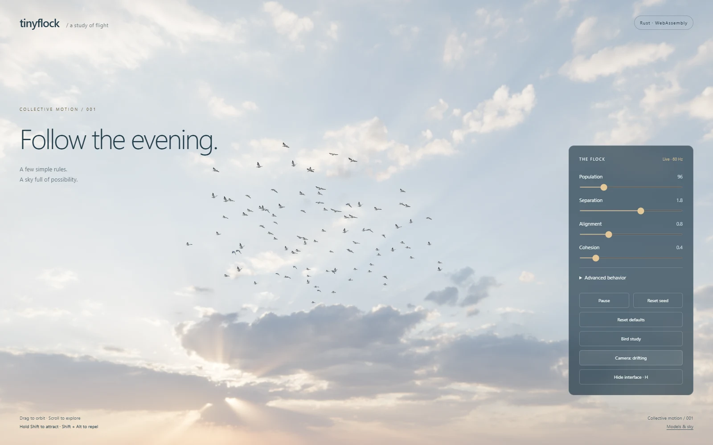
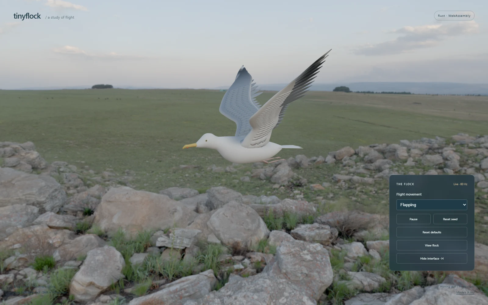

# tinyflock

A few simple rules and a sky full of birds. A tiny C++23 and Rust flocking library with a browser playground.

[Live demo](https://varnholt.github.io/tinyflock/) · [Source](https://github.com/varnholt/tinyflock)

Use the single C++23 header or the dependency-free [Rust crate](https://crates.io/crates/tinyflock). Both cores drive the same Three.js renderer and glTF birds. Choose **Simulation core** under **Advanced behavior**, or open the [Rust playground](https://varnholt.github.io/tinyflock/?core=rust).

The core has no rendering, windowing, or third-party dependencies. It models separation, alignment, cohesion, a soft spherical boundary, predictive agent/obstacle avoidance, attraction or repulsion, and caller-supplied accelerations. It provides a readable all-pairs reference and an optional spatial index. The caller owns the clock and supplies elapsed time through `std::chrono`.

The browser example loads a modelled herring gull from GLB and a photographic 4K countryside HDR. Each bird has independent wingbeat phases, gliding intervals, and banking. The same environment supplies the background and lighting, including the sun's direction, color, and relative strength. A separate **Bird study** view shows the asset close up, with flapping, gliding, and combined movement modes. The visual work is a prototype on the way to the realism target, not a claim of photographic accuracy.



## Native build

Requires CMake 3.25+ and a C++23 compiler/library with `std::expected` support. Verified locally with MSVC 19.44 and Emscripten 7.0.0.

```sh
cmake -S . -B build/native
cmake --build build/native --config Release
ctest --test-dir build/native -C Release --output-on-failure
```

Run `build/native/tinyflock_example` (Windows multi-configuration builds: `build/native/Release/tinyflock_example.exe`) for a headless example.

`tinyflock_steering_example`, built from [examples/steering.cpp](examples/steering.cpp), demonstrates a caller-owned moving waypoint, sphere obstacles, per-agent external acceleration, and spatial search. Routes and environmental fields remain ordinary caller code rather than requiring a renderer or a behavior framework.

Copy `include/tinyflock/tinyflock.hpp` into your project, or use `add_subdirectory` and link against `tinyflock::tinyflock`. There is no source file to compile separately. Examples and tests are enabled by default only for a top-level build. The library can also be installed with `cmake --install build/native --config Release --prefix <destination>` and consumed with `find_package(tinyflock CONFIG REQUIRED)`.

```cpp
#include <tinyflock/tinyflock.hpp>
#include <chrono>

int main() {
    using namespace std::chrono_literals;
    tinyflock::Simulation flock;
    flock.reset(256, 42);

    if (auto result = flock.step(1s / 60.0F); !result) {
        return 1; // result.error() identifies the validation failure
    }

    for (const auto& boid : flock.state()) {
        // Feed boid.position and boid.velocity into any renderer or consumer.
        (void)boid;
    }
}
```

## Browser demo

Requires Node.js 22.12+ (or a newer supported release), npm, Ninja, an activated [Emscripten SDK](https://emscripten.org/docs/getting_started/downloads.html), Rust, the `wasm32-unknown-unknown` target, and wasm-bindgen CLI 0.2.130. Emscripten 7.0.0 is the tested version. The toolchain in `.tools/emsdk`, if present, is local and excluded from source control.

After activating the SDK in your shell:

```sh
emcmake cmake -S . -B build/wasm -G Ninja -DCMAKE_BUILD_TYPE=Release -DBUILD_TESTING=OFF
cmake --build build/wasm
rustup target add wasm32-unknown-unknown
cargo install wasm-bindgen-cli --version 0.2.130 --locked
cargo build --locked --release -p tinyflock-web --target wasm32-unknown-unknown
wasm-bindgen --target web --out-name tinyflock_web --out-dir web/public/wasm-rust target/wasm32-unknown-unknown/release/tinyflock_web.wasm
cd web
npm ci
npm run dev
```

Windows PowerShell can use the helper below instead of the first two commands. It also supports NMake from Visual Studio when Ninja is unavailable:

```powershell
./scripts/build-wasm.ps1
./scripts/build-rust-wasm.ps1
```

Open the URL printed by Vite. Drag to orbit, scroll to zoom, hold Shift to attract the flock at the pointer, and hold Shift + Alt to repel. The panel controls population, rule weights, and pause. **Reset seed** restarts the flock with the current settings; **Reset defaults** restores the population, rule weights, running state, camera framing/drift, flock view, and animation mode/phase. Mouse steering requires a keyboard; orbit and zoom also work with touch.

**Advanced behavior** starts collapsed. It exposes predictive avoidance (enable, seconds of lookahead, center clearance), flight limits, steering mode, viewing cone, perception/separation radii, nearest-neighbor limit, altitude keeping, boundary, obstacle course and margin/lookahead, uniform external acceleration on all three axes, pointer strength/radius, random seed, and spatial-search selection. Coupled limits stay valid when adjusted. Amber wire spheres visualize the same solid obstacle geometry passed to C++. Diagnostics show candidate pairs and agents avoiding per step. **Reset defaults** restores every advanced setting; **Reset seed** preserves them. The advanced panel scrolls within the viewport on smaller screens.

**Hide interface** or **H** hides the overlays for a clean view; **H** or **Escape** restores them. A **Show controls** button at the bottom right fades out after two seconds and remains available by hover, keyboard focus, or tapping that corner. Open `?ui=hidden` to start with overlays hidden. Keyboard shortcuts do not intercept typing in form controls.

**Bird study** switches to a close-up of the model and its authored flight cycle. Open `?view=bird` to start there. The population slider controls the flock; the study view always shows one bird. The default flock has 96 birds with more spacing and weaker cohesion than the core defaults, plus a demo limit of 384. **Camera: drifting** gently orbits and tracks the flock's smoothed centroid; toggle it for a fixed camera. Manual orbiting suspends automatic rotation for six seconds, then gradually resumes it. Flock camera pitch and distance keep the birds against sky with at most a narrow horizon strip; panning is disabled. The photographed foreground has no geometric depth and cannot act as nearby terrain. The study view allows a wider range of angles.

The example opts into forward-flight steering: a 6–8 units/s speed envelope, a 2 units/s² acceleration limit, a common initial travel direction, and early boundary turns. Birds steer through broad arcs rather than braking through zero to reverse. Hermite interpolation joins simulation positions and velocities; the model's +Z forward axis follows the exact tangent of that rendered path, without a separate heading lag. Bounded banking responds to simulation acceleration and rotates around the forward axis. Animation phases accumulate elapsed playback time, so changing playback speed cannot jump through the authored wing cycle.

The gull preset also uses a 270° viewing cone, the seven nearest visible neighbors for alignment/cohesion, and a preferred flight altitude with a ten-second response. Separation considers all close birds, including those behind the viewing cone or outside the social-neighbor limit. These are configurable steering behaviors, not a claim of measured gull ethology.

Predictive avoidance is enabled in the demo with a four-second lookahead and 2.5-unit center clearance. The core projects relative motion to closest approach within the horizon, then steers around the encounter requiring the strongest correction. Its search is independent of social perception and viewing cones. Correction strength fades as the projected miss distance improves. Centered approaches choose reciprocal lateral directions; forward-flight agents turn sideways rather than brake. Avoidance reserves acceleration before the other steering rules and removes their opposing component. Equal-velocity, receding, and safely separated trajectories do not trigger a prediction.

The library leaves agent prediction disabled by default. Enable it through `Config`:

```cpp
tinyflock::Config config{
    .avoidance = tinyflock::Avoidance{
        .lookahead = std::chrono::seconds{3},
        .clearance = 2.0F,
    },
};
auto result = flock.configure(config); // Check the returned std::expected.
```

Sphere obstacles are supplied with `set_obstacles(span)` and remain until replaced or cleared, including across `reset`. Obstacle prediction works independently of agent-prediction enablement, using `obstacle_lookahead` and `obstacle_margin`. `step(elapsed, accelerations)` accepts one world-space acceleration per agent, valid for that step only. Both obstacle and agent avoidance take priority over conflicting external inputs. Inputs, obstacles and targets are value data; the library retains no caller pointers or callbacks.

The browser adapter exposes `settings()` and `configure(settings)` for complete configuration snapshots. Rejected snapshots leave settings and state unchanged. `restoreDefaults()` restores the demo configuration/environment/inputs; the UI then restarts the selected default population. Settings snapshots use degrees for the viewing cone and numeric seconds for chrono durations. The core API keeps radians and chrono types. Native tests cover independent acceleration inputs, obstacle recovery/passes, invalid-input rollback, and exact grid/reference agreement; the WASM checks cover configuration, instance isolation and defaults, and browser checks exercise the advanced panel and its mobile layout.

Native multisample antialiasing is complemented by up to 2× supersampling per axis, including on 1× displays, with a four-million-pixel budget (never below native CSS resolution). This improves coverage of small wings without changing simulation speed. Feather transmission is limited to the thin wing regions and strengthens when viewing toward the HDR sun. The photographed rays remain part of the panorama; there is no simulated volumetric cloud shadow or beam geometry.

The visible HDR remains intact. For lighting, the dominant bright sky lobe is removed from an ambient copy and its integrated RGB radiance supplies a directional source. The remaining sky supplies image-based lighting through PMREM; feather transmission uses the same source. Background and birds share AgX tone mapping and exposure. This is a relative HDR lighting approximation, not an absolute lux calibration. A 2K panorama is selected when the GPU texture-size limit cannot accommodate 4K.

`npm run build` creates `web/dist` for static hosting, including the compiled WASM files. Build WASM first. `npm run preview` serves the production output locally. Relative asset paths support hosting under a repository subpath.

After building both WASM backends, `node --experimental-strip-types tests/wasm-smoke.mjs` from the repository root checks both adapters, including instance isolation, state transfer, invalid input, configuration, defaults and cross-backend agreement. GitHub Actions runs native C++/Rust checks on Windows/Linux and builds/checks both WASM backends plus the browser bundle on Linux. The demo deploys to GitHub Pages after all checks pass.

`npm run check:motion` and `npm run check:lighting` in `web` check interpolation, frame-rate-independent attitude, continuous animation phase, and HDR light accounting. `node web/scripts/trace-motion.mjs --check` from the repository root checks the compiled WASM flight envelope for a seeded 60-second run. These complement the native simulation tests.

`npm run check:visual` in `web` launches a headless browser, checks startup and interactions, reports failed assets/runtime/shader errors, and captures desktop/mobile images in `build/visual` plus README previews in `docs`. Puppeteer normally downloads Chrome during `npm ci`; an installed browser can be selected with `PUPPETEER_EXECUTABLE_PATH`. It uses the browser's default GPU backend. `TINYFLOCK_SOFTWARE_RENDERING=1` opts into SwiftShader for diagnostics; the tested software backend shows HDR background corruption despite passing runtime checks, so screenshots require visual review. `node scripts/record-flight.mjs` records a ten-second canvas preview in `build/visual/flight-motion.webm`.

Set `TINYFLOCK_CORE=rust` for the visual checks to exercise Rust through the same controls. Backend switching restarts the playground; it does not hot-swap an existing trajectory.

## Rust

```sh
cargo add tinyflock
```

The crate uses `std::time::Duration`, `Result`, and read-only slices, with the same steering features and validation contracts as C++. It contains no renderer, WASM dependencies or third-party dependencies. See [the Rust guide and examples](rust/README.md).

To work on this checkout:

```sh
cargo test --workspace --locked
cargo run -p tinyflock --example steering
cargo build --release -p tinyflock --example parity
node scripts/check-parity.mjs
```

Build the native C++ tests first for the last command. Thirteen shared scenarios cover seeded resets, free/forward flight, head-on/crossing/overtaking/vertical encounters, obstacles, external inputs, targets, nearest-neighbor selection, startup and altitude recovery. Comparisons use floating-point tolerances; exact cross-language trajectories are not promised. The spatial index is also compared exactly against the all-pairs reference within each implementation.

## Demo assets

The GLB, 4K HDR, and 2K fallback are included; the demo makes no runtime requests to third-party asset servers. The authored gull source and rig are in [assets/gull](assets/gull/README.md). The HDR's authors, source URLs, and CC0 terms are recorded in [the asset credits](web/public/assets/CREDITS.md). `scripts/fetch-demo-assets.ps1` restores both HDR files with pinned SHA-256 checks.

The Blender pipeline lives in `assets/gull/build.py` and requires no downloaded bird model. To regenerate the editable source and exports:

```powershell
& 'C:/Program Files/Blender Foundation/Blender 5.0/blender.exe' --factory-startup --background --disable-autoexec --python assets/gull/build.py
```

The script builds a continuous flight-shaped body, solid curved feather geometry, and a 35-bone weighted FK armature. It saves `assets/gull/gull.blend` with packed textures and looping `Flap` / `Glide` actions, exports `assets/gull/gull-rigged.glb` for conventional skinning, and bakes the actual rig into a 12-pose glTF morph-animation clip for the instanced browser flock. Rebuilding replaces the authored `.blend`; use a copy to retain manual edits. `assets/gull/check.py` checks skin weights, closed geometry, finite/symmetric deformation, loop continuity, and both exports. `assets/gull/render.py` renders review views from the saved rig. Blender is an offline authoring tool; the browser only loads glTF.



## Boundaries and contracts

- `include/tinyflock/tinyflock.hpp` contains the public API and inline implementation.
- `bindings/wasm.cpp` and `rust/wasm` each own a simulation per browser instance, convert numeric seconds into their core's duration type, and expose packed float state (`x, y, z, vx, vy, vz` per bird). `web/src/rust-adapter.ts` maps Rust's exports to the common browser interface. No simulation is duplicated in JavaScript.
- `web/` owns scheduling, interpolation, rendering, input, and presentation. `birds.ts` loads/batches the GLB and samples its Flight animation per instance. `motion.ts` handles interpolation, attitude, and playback clocks. `behavior.ts` binds the advanced controls to the WASM settings; `simulation.ts` describes that adapter. `environment.ts` and `lighting.ts` prepare the photographed sky and lighting.
- Core state is exposed as `std::span<const Boid>`. Treat spans as invalid after `step`, `reset`, or `set_state`. Copy if a snapshot must survive an update.
- C++ browser state views are borrowed. Consume or copy immediately; reset, destruction, or WASM memory growth can invalidate them. Rust exports copied typed arrays; the renderer consumes both through the same interface.
- `configure`, `set_state`, `set_target`, `set_obstacles`, and `step` return `std::expected<void, Error>`. Validation failures preserve the previous configuration, state, environment, target, and diagnostics. Allocation failures follow standard library behavior.
- `step` accepts finite durations from zero through 100 ms. A valid zero step does nothing; all supplied inputs are validated first. Use a fixed timestep (the demo uses 60 Hz); split longer intervals at the application boundary. The demo caps frame catch-up at 100 ms to keep interaction responsive.
- Distances use world units, speed uses units per second, and acceleration uses units per second squared. Configurable positive magnitudes must be in `[0.0001, 1000000]`; rule weights in `[0, 1000]`; separation radius cannot exceed perception radius. State and target coordinate components are limited to magnitude `1e9`; target radius uses the positive range and target strength is in `[-1000, 1000]`.
- `min_speed` defaults to zero and must be finite in `[0, max_speed]`. The default `Steering::free` preserves general boid behavior. Optional `Steering::forward_flight` requires a positive minimum speed and turns toward desired bearings with anticipatory boundary steering. `reset` initializes velocities at or above the configured floor; a slower caller-supplied state approaches the floor under the acceleration limit.
- `view_angle` is the full viewing cone in radians, in `(0, 2Ï€]`, defaulting to all directions. Stationary birds can see all directions. `max_neighbors` defaults to zero (all visible neighbors); a positive value selects the nearest N for alignment/cohesion, with state-index tie breaking. Separation remains omnidirectional within its radius. A neighbor limit is a behavior choice independent of spatial search.
- `preferred_altitude` is disabled by default; enable it with a finite height of magnitude at most `1e9`. Its critically damped vertical spring uses `altitude_response`, a chrono duration in `[0.1s, 3600s]` (default `8s`). It shares the acceleration budget with all other rules, so strong competing influences can prevent exact altitude keeping. The world boundary remains centered at the origin.
- Optional `avoidance` takes a finite `lookahead` chrono duration in `[0.01s, 60s]` and `clearance` in `[0.0001, 1000000]` world units. Clearance is the desired distance between centers, not a per-agent radius. Prediction assumes constant relative velocity during the lookahead, with the strongest required correction winning (equal scores use state order). It is a steering heuristic, not a collision guarantee: dense encounters, insufficient turning room, short horizons, and already overlapping agents can defeat it. Existing agent overlap recovery remains separation's job. Prediction adds no per-pair allocations.
- `SphereObstacle` contains a center and a positive radius. Centers use the state coordinate bound (`1e9` per component), radii use `[0.0001, 1000000]`. Geometry is copied by `set_obstacles`; its input may alias `obstacles()`. The read-only obstacle span remains valid until replacement or destruction. Spheres are static until replaced by the caller. `obstacle_lookahead` uses `[0.01s, 60s]` (default `4s`) and `obstacle_margin` uses `[0, 1000000]` (default `1`). Obstacles are steering influences, not hard collision constraints or mesh collision geometry.
- `step`'s optional acceleration span must be empty or match the agent count. Each component must be finite with magnitude at most `1e6`. These inputs are added before shared acceleration limiting and avoidance priority, are not retained, and do not change the speed envelope. They model caller-defined steering/acceleration, not an aerodynamic wind model.
- All birds read the same previous state before updates are committed. `NeighborSearch::all_pairs` remains the default `O(n²)` reference. `spatial_grid` builds a sorted uniform cell index and queries adjacent cells; cell size conservatively covers perception and predictive motion using actual velocities. Candidate indices are processed in reference order. Tests compare exact trajectories across modes. Sparse populations benefit; dense flocks or long lookahead distances can still approach quadratic work. Obstacles are checked separately against every agent. The demo defaults to the grid but caps rendered population at 384 for GPU cost.
- `stats()` returns directed candidate-pair checks, selected social-neighbor links, agents receiving avoidance corrections, and obstacle checks from the last positive step. `reset`/`set_state` clear diagnostics; invalid or zero steps preserve them. Scratch storage is reused once capacity is sufficient; the spatial index is rebuilt each positive step.
- The spherical boundary is a soft steering influence, not a collision constraint. No claim of aerodynamic realism is made.
- Seeds repeat within a build given the same inputs and steps. The implementations use the same MT19937 generator and explicit float conversion. Floating-point trajectories are not promised to match exactly across compilers, architectures, or languages.
- `reset` clears the pointer target and preserves configuration and obstacles. Existing velocities are limited on the next positive step if configuration lowers the speed limit; normal acceleration bounds assume initial velocity already respects the speed limit.

## Next milestones

1. Refine flight mechanics and directional poses against reference footage while preserving the authored model and animation.
2. Refine atmosphere and add navigable landscape geometry with documented asset redistribution terms.

The code and authored gull assets are distributed under the [MIT license](LICENSE). The landscape HDR has its own documented CC0 terms. Timestamped historical folders are preserved locally and excluded by `.gitignore`, along with build products, toolchains, and dependencies; they are not part of the source distribution.
